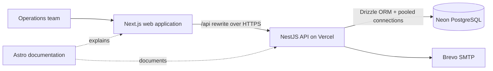
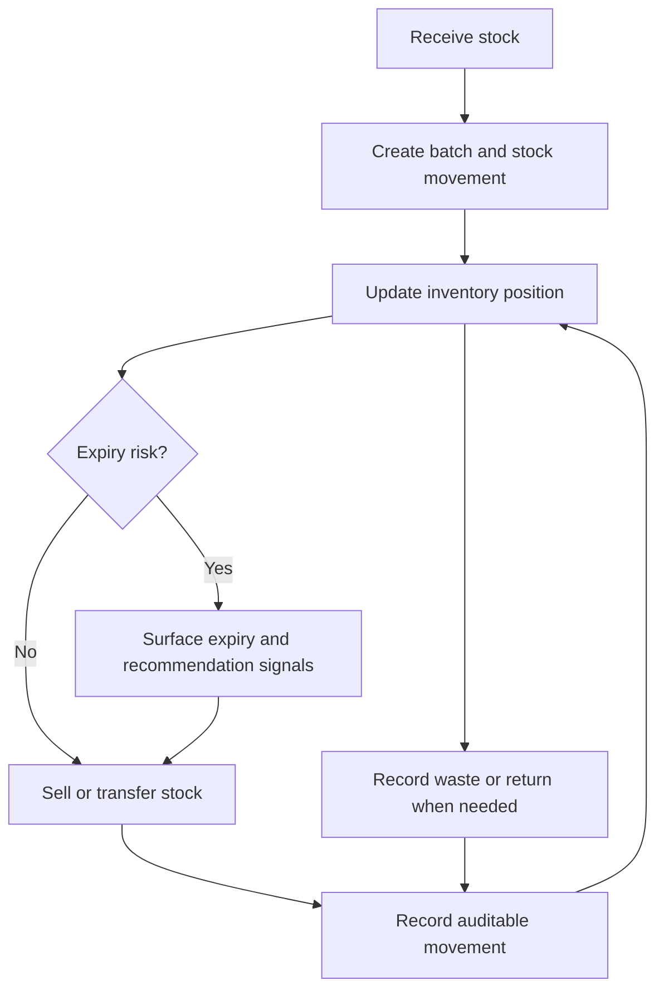

# Food Intelligence Platform

> A production-oriented operations platform for food businesses that turns everyday stock activity into clear, actionable decisions.

[](https://food-intelligence-platform-web.vercel.app/)
[](https://food-intelligence-platform-docs.vercel.app/)

**[Open the live application](https://food-intelligence-platform-web.vercel.app/)** · **[Read the documentation](https://food-intelligence-platform-docs.vercel.app/)** · 🎥 **Loom walkthrough — Coming soon**

## The problem

Food businesses make dozens of decisions every day: what arrived, what sold, what is close to expiry, which location holds stock, and what was wasted. When that information lives in notebooks, spreadsheets, or disconnected tools, inventory counts drift and decisions arrive too late.

Food Intelligence Platform brings those operational events into one auditable workflow. It is designed for teams that need dependable inventory records today and a clean foundation for smarter recommendations tomorrow.

## A simple way to think about it

Imagine a small grocery, restaurant, or food distributor as a busy kitchen. Ingredients move from receiving to storage, between locations, into sales, and sometimes into waste. The platform acts like a shared operations ledger: every movement updates the available balance, preserves its reason, and gives the team a current picture of the business.

That means a manager can investigate an expiry risk, a stockkeeper can record a transfer, and an owner can review sales and waste from the same source of truth.

## What the platform does

| Operational area    | Supported workflow                                                                                            |
| ------------------- | ------------------------------------------------------------------------------------------------------------- |
| Identity and access | Secure sign-in, session management, role-aware access, and team administration.                               |
| Business setup      | Businesses, locations, team members, roles, and location-level access grants.                                 |
| Product catalog     | Products, units, categories, suppliers, and reusable catalog information.                                     |
| Inventory           | Receipts, batches, stock positions, FIFO/FEFO-aware allocation, transfers, adjustments, and movement history. |
| Sales and returns   | Record sales, capture bounded returns, and keep inventory movements connected to the transaction.             |
| Waste tracking      | Record waste and customer-disposal events with quantities and reasons.                                        |
| Visibility          | Expiry views, operational analytics, and rule-based discount recommendations.                                 |

The application is deliberately scoped around real operating work rather than a generic dashboard. Its web routes cover workspace setup, catalog, inventory positions and batches, sales, returns, waste, expiry, analytics, team settings, and account settings.

## Live product

| Service               | Production URL                                                                                         |
| --------------------- | ------------------------------------------------------------------------------------------------------ |
| Web application       | [food-intelligence-platform-web.vercel.app](https://food-intelligence-platform-web.vercel.app/)        |
| Product documentation | [food-intelligence-platform-docs.vercel.app](https://food-intelligence-platform-docs.vercel.app/)      |
| API readiness check   | [food-intelligence-api.vercel.app/health/ready](https://food-intelligence-api.vercel.app/health/ready) |

## Architecture



The browser-facing application is a Next.js app. It forwards API requests through a server-side rewrite, while the NestJS API applies authentication, validation, authorization, and business rules. The API is deployed as a Vercel serverless handler and reuses its initialized Nest application on warm invocations. PostgreSQL data is hosted on Neon; production uses a pooled connection URL and migrations are a separate deployment operation, not a serverless startup task.

## A core workflow



Important state changes are handled as database-backed workflows, not only as UI updates. Inventory, sales, returns, and waste flows create traceable movement records and preserve the business context that explains a balance change.

## Engineering decisions that matter

### Correctness over convenient CRUD

Inventory is difficult because quantities are not independent form fields. A receipt creates stock; a sale or waste event consumes it; a transfer moves it between locations. The API uses PostgreSQL transactions for multi-step operations so related records are committed together or not at all. Drizzle schema constraints and domain checks reinforce the same rules in the database.

### Authorization is part of the data model

The system models platform roles, business membership, and location grants rather than treating authorization as a single frontend switch. NestJS guards and services enforce access rules at the API boundary, where they belong.

### Production-safe application boundaries

The API validates incoming DTOs with a whitelist, enables CORS only for configured origins with credentials, uses secure cookie settings in production, and can keep Swagger disabled in production. Secrets stay in runtime environment configuration rather than source control. The web app includes browser-facing security headers and sends API traffic through a controlled rewrite.

### Deployable as a real system

The repository contains a Docker Compose workflow for local services, a GitHub Actions quality workflow, Vercel configuration for the API, web, and static documentation deployments, and a separate Drizzle migration command. This keeps local development, CI, schema changes, and serverless runtime responsibilities distinct.

## Technology stack

| Layer          | Technologies                                                                        |
| -------------- | ----------------------------------------------------------------------------------- |
| Frontend       | Next.js 16, React 19, TypeScript                                                    |
| Backend        | NestJS 11, Express adapter, TypeScript                                              |
| Data           | PostgreSQL, Neon, Drizzle ORM, `pg`                                                 |
| Authentication | Argon2 password hashing, JWT access tokens, rotating refresh sessions, HTTP cookies |
| Email          | Nodemailer with Brevo SMTP in production; Mailpit in local Docker development       |
| Documentation  | Astro, Mermaid                                                                      |
| Delivery       | Vercel, Docker Compose, GitHub Actions, npm workspaces                              |

## Business use cases

- A restaurant operator receives ingredients by batch, reviews upcoming expiry, and records unavoidable waste with a reason.
- A multi-location retailer transfers stock between sites while retaining location-aware quantities and movement history.
- A food distributor records sales and returns without losing the traceability needed to explain on-hand stock.
- An owner reviews operational signals before making a markdown or replenishment decision.

## Quality and delivery practices

The repository includes focused automation for API quality:

- Type checking, linting, formatting, tests, production build, and dependency audit in GitHub Actions.
- PostgreSQL-backed CI integration coverage using an isolated test database.
- Explicit schema generation and migration commands through Drizzle.
- Separate API readiness endpoint for deployment verification.

Run the relevant checks from the repository root:

```bash
npm run typecheck
npm run lint
npm run test
npm run build
npm run web:check
npm run web:build
npm run docs:check
npm run docs:build
```

## Local development

**Prerequisites:** Node.js 24.15 or newer, npm, and either Docker Desktop or a PostgreSQL database.

```bash
git clone https://github.com/jobayermannan/food-intelligence-platform.git
cd food-intelligence-platform
npm ci
```

For the full local stack, configure the required local environment values and start Docker Compose:

```bash
docker compose up --build
```

Or run services from the workspace scripts:

```bash
npm run dev        # API
npm run web:dev    # Next.js web app
npm run docs:dev   # Astro documentation
```

Use [`.env.example`](.env.example) and [`deploy/production.env.example`](deploy/production.env.example) as variable-name references. Never commit real credentials. Run database migrations deliberately with `npm run db:migrate`; they are not part of normal API startup.

## Project map

```text
food-intelligence-platform/
├── apps/
│   ├── api/       # NestJS domain API, Drizzle schema and migrations
│   ├── web/       # Next.js operations interface
│   └── docs/      # Astro product and technical documentation
├── deploy/         # Deployment configuration and environment templates
├── docker/         # Local container build definitions
├── .github/        # CI quality workflow
└── docker-compose.yml
```

## Planned intelligence layer

The current recommendations are rule-based operational signals. Machine-learning forecasting, demand prediction, and automated optimization are **future work**, not current product claims. The present system is intentionally building the reliable event history and data model those capabilities would require.

## What this project demonstrates

- Designing a domain model where inventory movements remain auditable across receipts, sales, returns, transfers, adjustments, and waste.
- Building a typed, modular NestJS API with validation, authorization boundaries, transactional business workflows, and PostgreSQL persistence.
- Delivering a modern Next.js operations UI alongside living Astro documentation.
- Preparing a deployable monorepo with CI checks, Docker-based local development, Neon migrations, and Vercel serverless deployment.
- Making technical trade-offs visible: the project distinguishes implemented capabilities from explicitly planned AI/ML work.

## Explore in more detail

- [Product domain and business rules](PRODUCT_DOMAIN.md)
- [User manual](USER_MANUAL.md)
- [Codebase map](CODEBASE_MAP.md)
- [Database design](DATABASE_DESIGN.md)
- [Migration plan](MIGRATION_PLAN.md)
- [Backend audit](BACKEND_AUDIT.md)
- [Deployment guide](deploy/README.md)

---

Built as a portfolio-quality full-stack system for solving the operational reality behind food inventory—not just displaying it.
